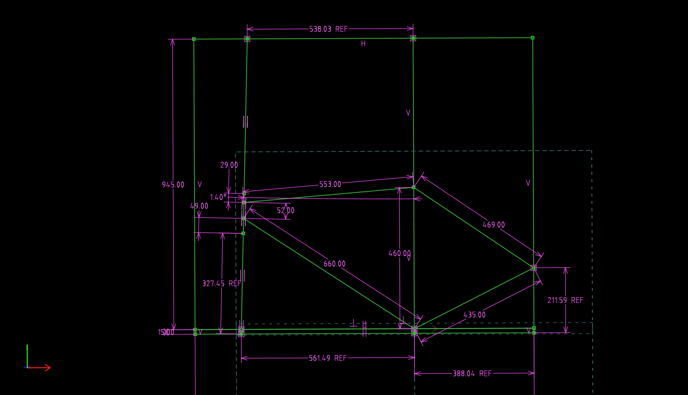
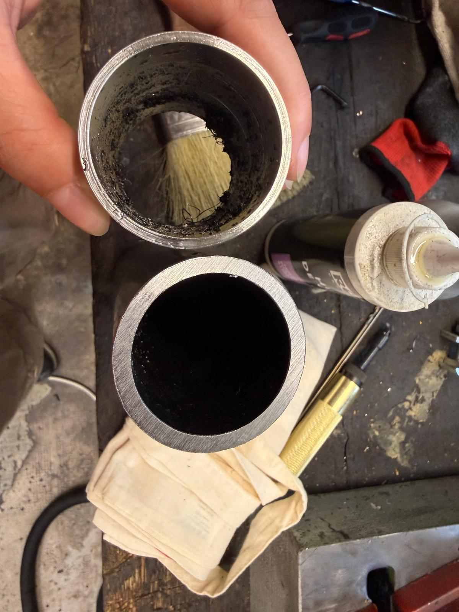
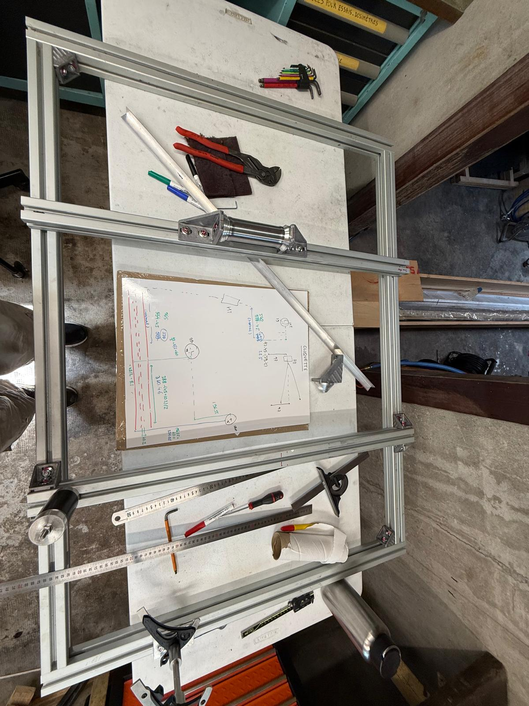
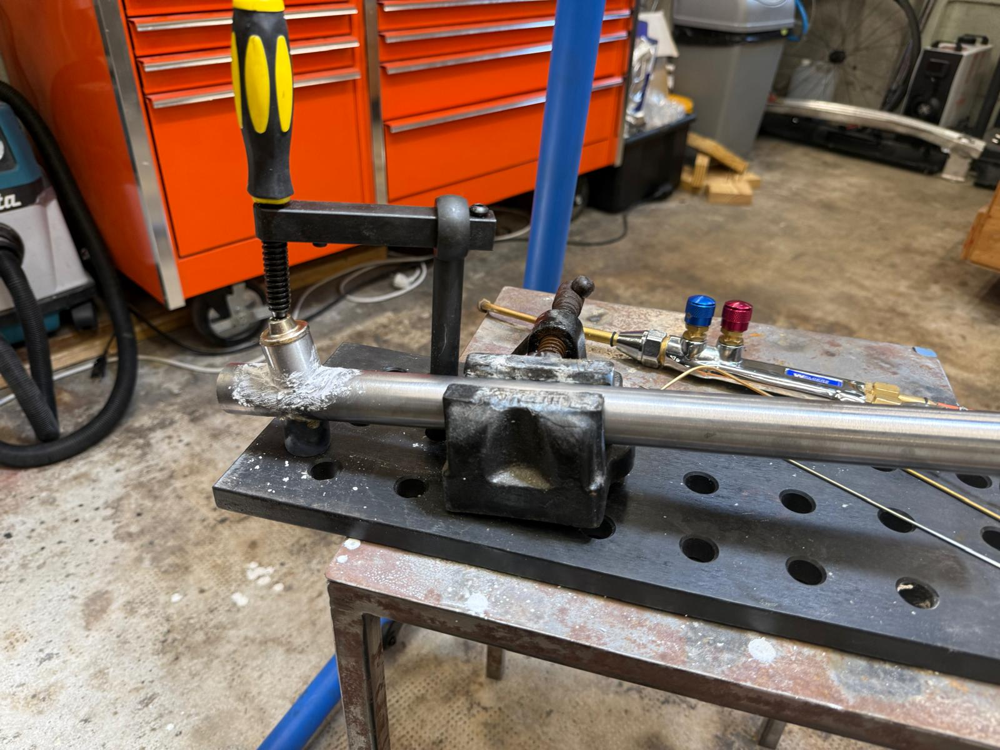
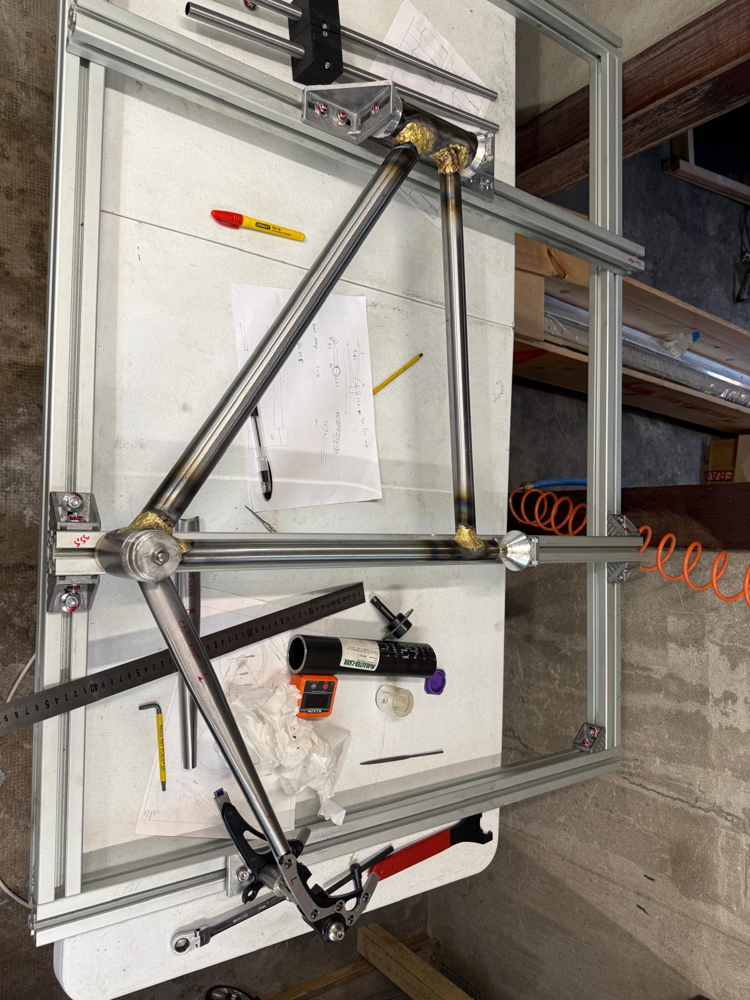

#  cliquette 

made in grenoble with lots of love, sweat and flux.
currently hibernating.

a fillet brazed steel bike: Rohloff hub, Gates belt, SON dynamo, disc brakes, 700c x 40 mm tyres.

## geometry

adapted & inspired by the Trek Checkpoint SL 5, 54 cm: https://geometrygeeks.bike/bike/trek-checkpoint-sl5-2021/

(the numbers below match the 2022-2023 listing: https://bikeinsights.com/bike-geometries/640d62a8c4a612001b5131e1-2023-trek-bikes-checkpoint-sl-5-54-cm)

| | cliquette | Checkpoint SL 5, 54 cm |
|---|---|---|
| head angle | 71.8° | 71.8° |
| seat angle | 73.2° | 73.2° |
| BB drop | 76 mm | 76 mm |
| chainstay | 435 mm | 435 mm |
| front-centre | 617.8 mm | 617.4 mm |
| fork rake | 45 mm | 45 mm |
| fork axle-to-crown | 405 mm (+ 12 mm external lower headset cup) | not published, ~410 mm by calculation |
| head tube | 130 mm | 125 mm |
| stack | ~580 mm | 571 mm |

cliquette numbers are from `bike_final_after_main_triangle_brazing.bcad`. Stack comes out ~8-11 mm higher than the Checkpoint (longer head tube + external lower headset cup) = a Checkpoint with ~10 mm of spacers. So: keep the fork at 405 / 45, zero spacers.

more drawings in [bike_geometry](./bike_geometry), part docs in [parts_docs](./parts_docs).

## parts

- BB shell: McMaster 89955K601 Easy-to-Weld 4130 Alloy Steel Round Tube, 0.188" Wall Thickness, 2" OD, 1 Foot Long
- Tubing (ZON = Columbus Zona):
    - TT ZONM11560 (ref 104)
    - DT ZONL12670001 (ref 103)
    - ST ZON113640 (ref 78)
    - Seatstays ZON615560 x2 (ref 85)
    - Chainstays ZON114OV425 x2 (ref 79)
    - HT HT2010 (Paragon, for 44 mm cups)
    - Seatclamp ZSC300
- Steerer: Steerer, Steel, Tapered 1-1/8" to 1-1/4", 9" Long × 1 (firsthand framebuilding) - NOT used for the crown fork (needs a straight 1-1/8"), spare
- Rear dropouts:
    - right side (drive):
        - Polydrop QR. open up: solves belt opening.
        - Adaptor gates - rohloff beltline
        - Gates sprocket
    - left side (disc):
        - Polydrop
        - OEM2 axle plate (drill a hole on the dropout to hold the oem rather than have monkey bone also because the polydrops i got are not iso). From https://www.rohloff.de/en/service/handbook/oem
- Front dropouts:
    - SON SL Stainless Steel Dropouts - Wide Braze Tab. Product code: 38069 (6 mm thick, 16 mm braze tab, 2 eyelets)
    - SON SL Contact Parts Kit with Cable Exit - 45 degree
- Hubs:
    - rear: 36 hole OEM DB TS Rohloff. O.L.D: 135
    - front: SON 28 SL 6-Bolt Disc Dynamo Hub - 9 x 100mm - Red. Product code: 38808H36. Holes: 36
- Headset: Cane Creek Hellbender 70 Mid-Range Headset - Tapered - ZS44/28.6 | EC44/40 - red
- EBB: PF30-EBB-BLK Eccentric BB for PF30 & 24mm (Shimano) Cranks - Black
- Gates sprockets and crankset:
    - Gates CDX BLACK Rear Sprocket Rohloff - 20T (78980556)
    - Gates CDX Crank Set Direct Mount Rohloff Beltline - 50t (CDXKGA50DMR170)
- Wheel: 700, 40mm tire
- tube blocks https://www.thingiverse.com/thing:4557823
- jig bits https://ideas2cycles.com/simple-framebuilding-jig/. more jig ideas: https://theframebuilders.com/bike-jigs/

## good resources

- brazing: https://www.youtube.com/watch?v=OjRMbBl_Tbs, https://www.youtube.com/watch?v=fzI3QHfZPUs, https://www.youtube.com/watch?v=Y2CnJ9lmlQo, brompton: https://www.youtube.com/watch?v=G0zAORVqnaU
- oxy-propane info: https://noviceframebuilder.co.uk/personal-articles/oxy-propane-brazing-update-3/, https://www.bikeforums.net/framebuilders/1187246-propane-flame.html, [oxy acetylene] https://thejimbosliceworkshop.com/temperature-of-oxy-acetylene-flame/
- start-to-finish bike building: https://www.youtube.com/watch?v=iDx8c7Tq4PY&list=PLUJnSFSlakCKcqDTKFwkHSVIxR1PRioMY

## stuff already done (summer 2026)

- 26 - 27/07: Mitered, bored and faced BB from McMaster blank

 [before / after dims]

- 27 - 28/07: Set up jig, practiced brazing icicle (Paul Brodie exercise, first brazing video in good resources)

- 29/07: Miters: DT-BB, DT-HT (largest butt there per Paul Brodie) yikes - this did not fit! jig setup was wrong in several ways. On to cliquette v3.2; practice brazing ++

- 30/07: Practice brazing; Mitered ST-BB, ST notch (DT-BB junction)

- 31/07: Practice brazing: tube bends before braze snaps - that's good!; NS + brass fillet brazed BB-DT, checked alignment and bent tube back into shape; holes in BB for DT + ST + drain hole (guestimated). Cleaned up flux on DT-BB. Mitered TT-ST and TT-HT - could have used more length on this! large butts. larger butt to HT per Paul Brodie.

- 01/08: Filed ST notch to fit with brazing. Holes in HT for TT and DT; NS + brass fillet brazed the main triangle! (tacked in Paul Brodie order: https://www.youtube.com/watch?v=lDHqMyBHAv0, NS all, and then brazed. do over on a section of TT-HT); faced and reamed HT

- 02/08: Cut to length & mitered and slotted chainstays and added relief cut. Filed dropout inserts down. Cliquette went into hibernation.

## to do next

rear triangle:
- [ ] dry-fit, then silver braze the brass guide tubes into the left chainstay (BEFORE brazing the chainstays)
- [ ] hole in seatstays for brazing
- [ ] tack, NS / Brass / Silver braze chainstays
- [ ] Face and ream BB
- [ ] Check + fix alignment
- [ ] Miter seatstays to fit
- [ ] tack, NS / Brass / Silver braze seatstays
- [ ] bridges for seatstays and chainstays to fit, with a bottle boss in each for the mudguards
- [ ] rear disc tab, fitted with the real hub + rotor + caliper

main triangle:
- [ ] guide tubes through the down tube
- [ ] 2 grommet holes in the top tube for the rear light wire (underside, near the head tube + near the seat cluster, within a few cm of the tube ends)
- [ ] bosses: bottle, eyelets
- [ ] ream seat tube, then cut the slot

fork:
- [ ] order: blades + Paris-Brest crown (Framebuilder Supply), 395 mm steerer (Metal Guru), 52/30 crown race BAA0009S (Cane Creek)
- [ ] build a fork fixture (flat plate + dummy axle)
- [ ] build the fork: guide tube + dynamo wire holes while the blades are loose, braze, dropouts, forward-facing threaded hole / boss at the crown for the lamp mount, disc tab last

then:
- [ ] build wheels
- [ ] rust protection inside the tubes, paint
- [ ] write up jig setup and chainstay setup here

## shopping status (22/11)

bought:
- [x] levers: Shimano 105 ST-R7020, 2x11 pair
- [x] SON Ladelux headlight + accessories (handlebar switch, charging cable, coaxial connectors)
- [x] internal routing (McMaster): brass guide tube 1/4" OD, 3 ft x 6 + 1 ft x 2 to practice, tube sleeve for hand bending, EPDM grommets (pack of 100), black heat shrink 1/4" ID (pack of 10)
- [x] ISO disc tab for the fork
- [x] bosses: bottle bosses, reinforcing stars, eyelet bosses
- [x] Gilles Berthoud mudguards, 700C x 50 mm
- [x] SON rear light, mudguard mount

still to buy:
- [ ] fork: Columbus pre-raked disc blades + Pacenti Paris-Brest crown (Framebuilder Supply), 395 mm steerer (Metal Guru), 52/30 crown race BAA0009S (Cane Creek)
- [ ] housing covers for the entry / exit holes (Framebuilder Supply)
- [ ] Gebla Rohbox + shift cables
- [ ] Gebla ShimKit - A22 or A21, after checking the production year on the levers
- [ ] Hope RX4+ calipers x 2 (mineral oil, red) - after measuring the mount on the left Polydrop insert
- [ ] brake hose (~2 m rear + ~1 m front) + Gebla connection sets with road flange nut x 2
- [ ] rotors, 160 mm: 6-bolt front, Rohloff 4-bolt rear (+ caliper adapter if needed)
- [ ] SON fork crown mount for the lamp - short or long, once the fork exists
- [ ] handlebar (compact drop, 40 cm, 31.8)
- [ ] wheels: rims, spokes, tyres
- [ ] rust protection spray + straws, paint

still to finalize:
- [ ] rear caliper mount: measure the Polydrop hole spacing (~34 mm = flat mount, ~74 mm = post mount)
- [ ] front caliper: post mount on the IS tab with an adapter, or flat mount to match the rear
- [ ] ShimKit version: production year of the levers (2022 onwards = A22, older = A21)
- [ ] hose type: check what the Hope caliper fittings take
- [ ] enough coaxial connector sets? 2 needed (crown + front of top tube), optional 3rd at the seatstay bridge
- [ ] crown mount short or long
- [ ] rims / spokes / tyres
- [ ] badge, name plate, paintjob

## decisions so far (22/11)

- internal routing: everything internal, in brass guide tubes silver brazed (56%) into the frame, full-length housing / hose inside.
    - 2 x Rohloff shift cables + rear brake: down tube -> out just before the BB (EBB fills the shell, so ~10 cm exposed under the BB) -> left chainstay. Fit the chainstay guide tubes BEFORE brazing the chainstays. dry-fit first, chainstay is tight.
    - front brake: inside left fork blade (holes on inner / outer face, not front / back)
    - dynamo: front wire inside right fork blade (SL contact), exits near the top of the blade. Rear light wire through the TOP tube (not the down tube: the EBB blocks the way to the rear, and under the BB is the wettest spot), no guide tube, rubber grommets: in on the underside near the head tube, out on the underside near the seat cluster -> seatstay bridge -> along the mudguard. Leave a loop between lamp and top tube so the fork turns fully.
    - Ladelux switch cable (crown -> handlebar) and charging cable stay external: along the front brake hose, under the bar tape.
    - McMaster (BOUGHT, $100.61): brass tube 1/4" OD, 0.014" wall (0.222" ID), 3 ft [8859K188](https://www.mcmaster.com/8859K188) x 6 + 1 ft [8859K24](https://www.mcmaster.com/8859K24) x 2 to practice, tube sleeve for hand bending [2420A111](https://www.mcmaster.com/2420A111), EPDM grommets for 3/16" hole, 1/16" material thickness [9600K311](https://www.mcmaster.com/9600K311) (pack of 100), black heat shrink 0.25" ID, 1/2 ft lengths [6363K212](https://www.mcmaster.com/6363K212) (pack of 10)
    - housing covers for entry / exit holes: https://framebuildersupply.com/products/internal-housing-cover-2-10-packs
- bosses (BOUGHT): all stainless, silver brazed, from Framebuilder Supply
    - [bottle bosses](https://framebuildersupply.com/products/stainless-steel-water-bottle-bosses-pack-of-10) x 2 packs: 3 cages (2 on DT top + ST, 1 under DT) + 1 in each bridge + 1 under the fork crown for mudguards. 1/4" drill.
    - [reinforcing stars](https://framebuildersupply.com/products/water-bottle-boss-reinforcing-stars-stainless-steel-pack-of-10) x 1 pack
    - [eyelet bosses](https://framebuildersupply.com/products/eyelet-bosses-for-m5-bolts-stainless-10-100-packs) x 1 pack (mudguard stays at dropouts)
    - no rack -> no rack bosses
- disc brakes: IS tab on the fork, rear mount is already on the left Polydrop insert (check which standard, see calipers below) ([ISO tab](https://framebuildersupply.com/products/iso-disc-brake-tab-cast), BOUGHT), 160 mm rotors. Front = 6-bolt (SON), rear = Rohloff-specific 4-bolt rotor. Fit the tabs with the real hub + rotor + caliper in place.
- fork: steel, disc, Columbus disc-rated blades, 405 axle-to-crown, 45 rake, SON SL dropouts (wide 16 mm tab, slotted into the blade tip - matches the 16 mm tip of the pre-raked blades) angled forward (disc pushes the axle out of a QR dropout). Lugged crown + curved blades + straight 1-1/8" steerer (decided, see below).
- dynamo light + USB phone charging: SON Ladelux (BOUGHT, with accessories). Low beam 150 lux, high beam 200 lux, built-in buffer battery (1200 mAh), 5 W USB charging from a magnetic port on the handlebar switch. Compatible with the SL system. 
    - headlight: black, standing mount (do not mount upside down), "120 cm wire, connectors separate"
    - handlebar switch: 40 cm cable (20 cm does not reach from the crown to a drop bar)
    - charging cable with magnetic connector: 46 cm, USB-C or Apple to match the phone
    - SON coaxial connector set (male + female, soldered): cut the lamp wire short, one half on the lamp wire, the other on the wire coming up the right fork blade from the SL contact -> lamp unplugs at the crown
    - rear light (BOUGHT): SON rear light, mudguard mount, black housing / red lens. 2-wire (no frame return, as the Ladelux requires), standlight, comes with 1.9 m of coaxial cable. WIDE profile version (50-60 mm), to match the 50 mm mudguards.
    - mudguards (BOUGHT): Gilles Berthoud, polished stainless, 700C x 50 mm, short front, with fittings. Rolled edges -> the rear light wire tucks in. Drill for the bridge bosses, the crown boss and the rear light. Bridges + crown boss all at the same distance from the axle (tyre radius ~351 mm + 15-20 mm). Check 50 mm fits between the chainstays at the bridge (dimple the mudguard if tight). Front stay has to bend around the disc caliper.
    - rear wiring: the lamp's rear light lead is coaxial but only 12 cm. Thread the bare rear light cable through the top tube grommets first, then solder a coaxial connector on at the front (second connector set). ~160 cm crown to mudguard tail by estimate, 190 cm supplied -> measure on the frame before cutting. Optional third connector at the seatstay bridge so the mudguard comes off without pulling the wire.
    - lamp mount: SON aluminium fork crown mount (for disc forks, holds the lamp upright, bolts into a forward-facing hole at the crown). Short (37 x 40 mm) or long (45 x 52 mm) -> pick once the fork exists, lamp must clear the external lower headset cup.
- seat tube: ream after all brazing and before cutting the slot (adjustable reamer for 27.2 or a brake cylinder hone). No facing needed, file the top square.

## pending questions - fork, steerer, cane creek

- fork type: DECIDED, crown + curved blades. Tony (Framebuilder Supply, 22/11): crowns are not disc-specific, either Pacenti crown works, pick by the inside width the tyre needs; max rotor 180 mm (160 planned, fine); either 1-1/8" steerer works (just length and cost); no ETA on the steerer restock.
    - blades: [Columbus pre-raked disc blades](https://framebuildersupply.com/products/columbus-pre-raked-fork-blades-for-disc-28x19-oval-1-2-9-wall-45mm-rake-length-475) (28x19 oval, 1.2/.9, 45 rake, tip 16 mm OD, trim from the top only), $67.75 the pair
    - crown: [Pacenti Paris-Brest 1-1/8"](https://framebuildersupply.com/products/pacenti-1-1-8-paris-brest-fork-crown-56mm-inside-width-biplane-design), 56 mm inside, 138 g, $43.95, made for the 28x19 oval blades. 56 mm = 50 mm mudguard + 3 mm each side over the 40 mm tyre. The [MTB crown](https://framebuildersupply.com/products/pacenti-mtb-fork-crown-74mm-inside-width-biplane-design) (74 mm, 194 g) only makes sense for 50 mm+ tyres or 60 mm mudguards.
    - other 1-1/8" crowns for curved oval blades, checked 22/11 (need >= ~54 mm inside for the 40 mm tyre + 50 mm mudguard; crowns with a built-in 5.7 / 7 degree angle are for straight blades, not for the pre-raked ones):
        - fits as planned, in stock: Paris-Brest 56 mm (above); [Allotec Gravel Bi-Plane 60 mm](https://metal-guru.com/products/allotec-gravel-bi-plane-fork-crown-28-6-x-28-20) (Metal Guru, $25.95, 141 g, fender hole); [Long Shen 60 mm](https://metal-guru.com/products/long-shen-fork-crown-28-6) (Metal Guru, $19.95); Pacenti MTB 74 mm (wider than needed)
        - fits as planned, out of stock: Framebuilder Supply 60 mm full slope (A22-2), Long Shen Gravel+ 62 mm and ATB 72 mm (Metal Guru)
        - 50 mm = tyre ok, but mudguard must be 45 mm or dimpled: [Framebuilder Supply full slope](https://framebuildersupply.com/products/1-1-8-fork-crown-full-slope-design-50mm-inside-width) ($21.25, 203 g, in stock), [Metal Guru Bi-Plane](https://metal-guru.com/products/bi-plane-fork-crown-28-6-x-28-20) ($18.75, in stock)
        - too narrow: Artisan II 47 mm, flat 42 mm, semi-slope 36 mm
        - Metal Guru lists its sockets as 28x20, the blades are 28x19: same nominal oval, expect the usual squeezing to fit.
    - blades rarely drop into the crown sockets first try: squeeze the oval in a vise between wood blocks, file the socket if needed, never the blade.
    - when the crown arrives: measure crown race seat to underside. Tyre top is ~351 mm from the axle, so 405 a-c minus crown height must leave ~20 mm+ for the mudguard.
    - dropped: unicrown ([Columbus unicrown blades](https://framebuildersupply.com/products/columbus-unicrown-fork-blades-28-6mm-round-15mm-id-tip-1-2-1-wall-length-440) on the tapered steerer i have) - only as a fallback.
- steerer: straight 1-1/8" (28.6). Need 187 mm above the crown race seat (12 + 130 + 8 + 40 stem - 3) + the depth of the crown, so ~220-230 mm: any of these is long enough. Butted (thick) end goes in the crown, cut from the top.
    - [Metal Guru, Columbus 28.6 x 395, 2.0/1.55 wall](https://metal-guru.com/products/1-1-8-threadless-steer-28-6-x-395), $25.20, in stock on 22/11 -> buy this one
    - Framebuilder Supply [350 mm, 2.3/1.55](https://framebuildersupply.com/products/columbus-threadless-1-1-8-28-6-steerer-tube-350-length) and the lightweight 320 mm (2.0/1.2): both sold out, no ETA. Skip the lightweight one anyway (disc + touring load).
- cane creek headset: the Hellbender lower (EC44/40) wants a 40 mm crown race seat (1.5" steerer). Keep the headset, swap only the crown race:
    - straight 1-1/8" steerer -> Cane Creek 40-Series 52/30 mm steel crown race, BAA0009S, $13.99, in stock at [canecreek.com](https://www.canecreek.com/products/crown-races) on 22/11 (the alloy 110-Series one, BAA0463A, is out of stock)
    - CONFIRMED it fits the Hellbender (canecreek.com, 22/11): the EC44/40 lower takes a 52 mm bearing (52 x 40 x 6.5, 36 x 45 degrees), every complete Cane Creek assembly is 36 x 45 except IS47/33 and EC44/33, and Cane Creek states its crown races are interchangeable between headset series. The 52/40 race that came with the headset goes unused.
    - check the crown race seat on the Pacenti crown: 30.0 mm OD, may need cutting / facing to seat the race.
- brakes + shifting: hydraulic, Shimano 105 levers on a Gebla Rohbox (decided). Info: https://gebla.de/Rohbox/Info-Rohbox.html
    - levers (BOUGHT): Shimano 105 ST-R7020, 2x11 pair (left lever must be the 2x one, with a shift mechanism), from Procycles 43: https://www.procycles43.fr/9529-leviers-shimano-105-st-r7020-2x11v.html (189,90 € the pair on 22/11). Slimmer hood than GRX, suits small / medium hands and a bar with little flare. Being phased out by Shimano - fallback is GRX ST-RX600, same ShimKit.
    - Rohbox: https://www.sjscycles.co.uk/hub-spares/gebla-rohbox-shiftbox-black44988/ (£194.99). Replaces the Rohloff shift box. Uses standard Shimano road shift cables + housing, not included.
    - ShimKit: replaces the shifting internals of the levers, shift with the whole brake lever. A22 for levers made 2022 onwards: https://www.sjscycles.co.uk/hub-spares/gebla-rohbox-shimkit-a22-for-shimano-grx810-grx600-grx400-105-str7020/ (£149.99), A21 for older ones. Check the production year on the levers BEFORE ordering the kit. Crown tool helpful, not essential.
    - ShimKit A fits (per Gebla, https://gebla.de/Rohbox/Info-ShimKit.html): GRX820, GRX810, GRX600, GRX400, Dura-Ace 9020, Ultegra 8020, 105 ST-R7020, 105 ST-R7025. A22 vs A21 = thread on the left lever axle only (right-hand thread from 2022, left-hand before).
    - calipers: Hope RX4+, MINERAL OIL version (not DOT), red (decided). 4 piston, Hope lists it as compatible with 105 R7020. Comes with hose fittings and 2 sets of pads, no hose. DO NOT order 2 x post mount yet:
        - rear: the left Polydrop insert already has brake mounts (see images/Dropouts_(spares)_in_dummy_axle.jpeg). Measure the hole spacing: ~34 mm = flat mount -> rear caliper must be the FLAT MOUNT RX4+, and no rear IS tab. ~74 mm = post mount -> post mount caliper bolts straight on.
        - front: post mount RX4+ (HBSPC77R = post mount / mineral / red, to confirm on the shop page) on the fork IS tab with an adapter - or flat mount on the fork to match the rear.
        - shops: https://r2-bike.com/HOPE-Caliper-RX4-Postmount-for-Shimano-Campagnolo-Mineral-Oil-red , Westbrook Cycles £90 each https://www.westbrookcycles.co.uk/rx4__complete_post_mount_disc_brake_caliper-5641 (red out of stock 22/11), Gebla 119 € each.
    - hose: 5 mm Shimano SM-BH90 type (fits the 1/4" guide tubes), ~2 m rear + ~1 m front. Check which hose the Hope caliper fittings take before buying.
    - lever end of each hose needs the road flange nut, NOT the MTB one (it destroys the lever thread): Gebla connection set with flange nut + pin + olive, 7,90 € each, x 2.
- handlebars: drop bar, race feel but comfy for touring -> compact (reach ~70-80, drop ~115-125), slight flare. 31.8 clamp. Width 40 cm (shoulders 39.5), measured centre-to-centre at the hoods.

## to figure out

- wheels : rims (H PLUS SON TB14 is a narrow rim-brake rim -> rather a 36h disc rim, 19-23 mm inner: Ryde Andra 30, DT Swiss TK 540, Velocity Dyad / Cliffhanger), spokes (Sapim Race / DT Competition 2.0/1.8/2.0, Rohloff 2-cross, SON 3-cross), tires
- dynamo lights (bought, see decisions): crown mount short or long
- badge? name plate? paintjob?
- rust protection inside of tubes: extra long straws to put on end of rust protector spray can https://www.amazon.com/Replacement-Straws-Flexible-Plastic-Extension/dp/B09K3T496C?th=1, https://www.youtube.com/watch?v=3Yi6cjuqVHA

## painting inspo

https://www.behance.net/gallery/28363453/THE-BIKE-PROJECT , https://www.flickr.com/photos/54067629@N02/5062963141/in/photostream/, https://www.designboom.com/design/festka-bespoke-porcelain-spectre-model-12-18-2019/
