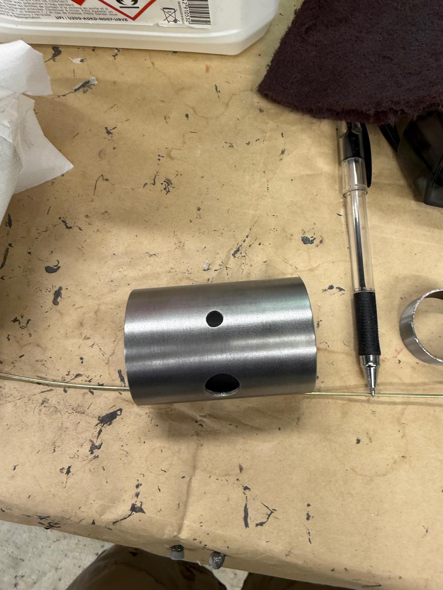
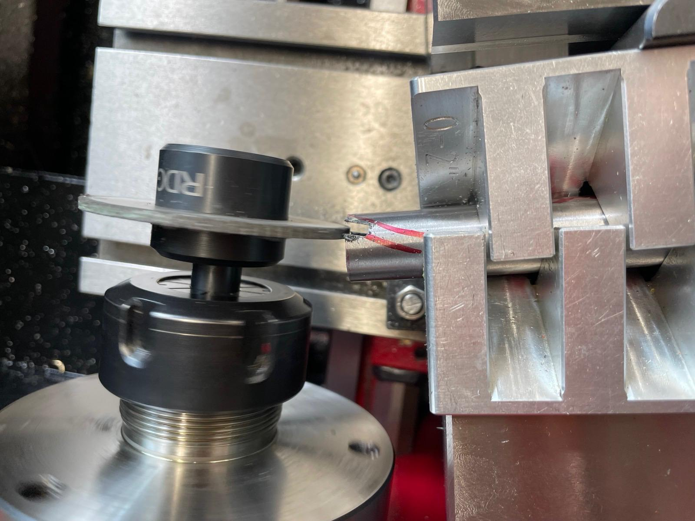
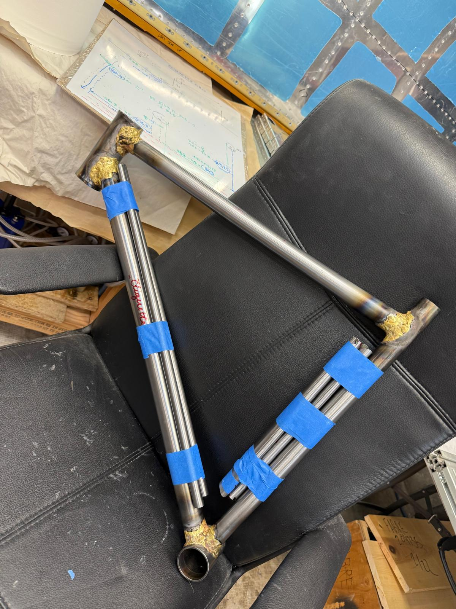

# cliquette
[currently hibernating]

parts: 

stuff already done: 
- 26 - 27 /07: Mittered, bored and faced BB from McMaster blank 

- 27 - 28 /07: Set up jig, practiced brazing icicle (Paul Brodie exercise: )

- 29 / 07: Miters : DT-BB, DT-HT (largest but there per Paul Brodie) yikes - this did not fit! jig setup was wrong in several ways. On to cliquette v3.2; practice brazing ++

- 30/07: Practice brazing; Mitered ST-BB , ST notch (DT-BB junction), 

- 31/07: Practice brazing: tube bends before braze snaps - that's good!; NS + brass fillet brazed BB-DT, checked alignement and bent tube back into shape; holes in BB for DT + ST + drain hole (guestimated). Cleaned up flux on DT-BB. Mitered TT-ST and TT-HT - could have used more length on this! large buts. lerger but to HT per Paul Brodie. 

- 01/08: Filed ST notch to fit with brazing. Holes in HT for TT and DT; NS + brass fillet brazed the main triangle! (tackecd in Paul Brodie order, NS all, and then brazed. do over on a section of TT-HT); faced and reamed HT; 

- 02/08: Cut to length & mitered and slotted chainstays and added relief cut. Filled dropout inserts down. Cliquette went into hibernation. 

jig setup: 

Chainstay setup: 

to do: 

to buy:  

to figure out: 
