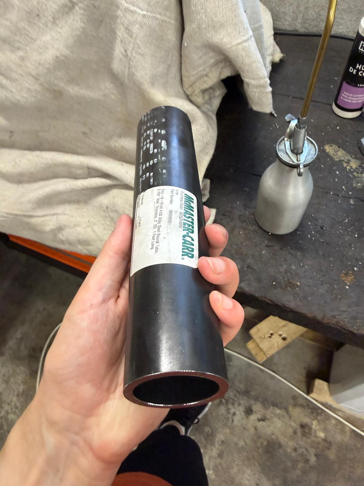
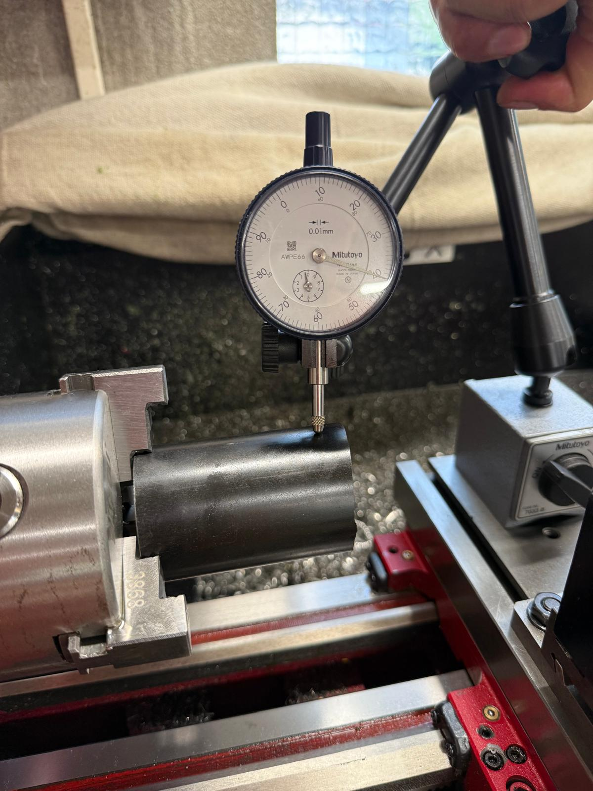
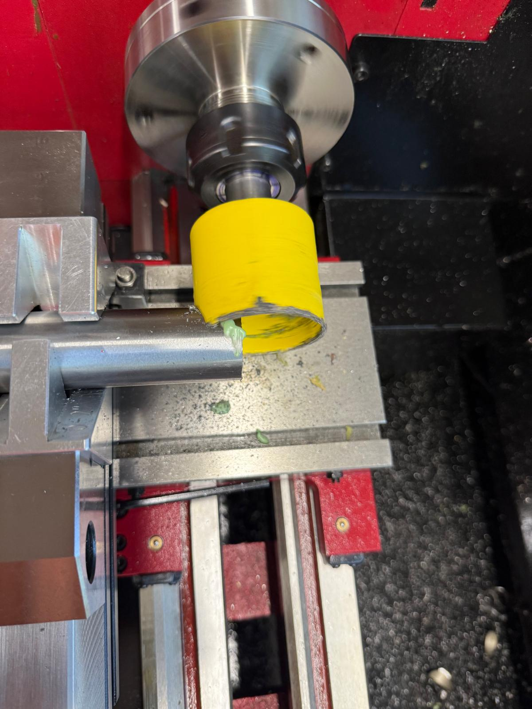
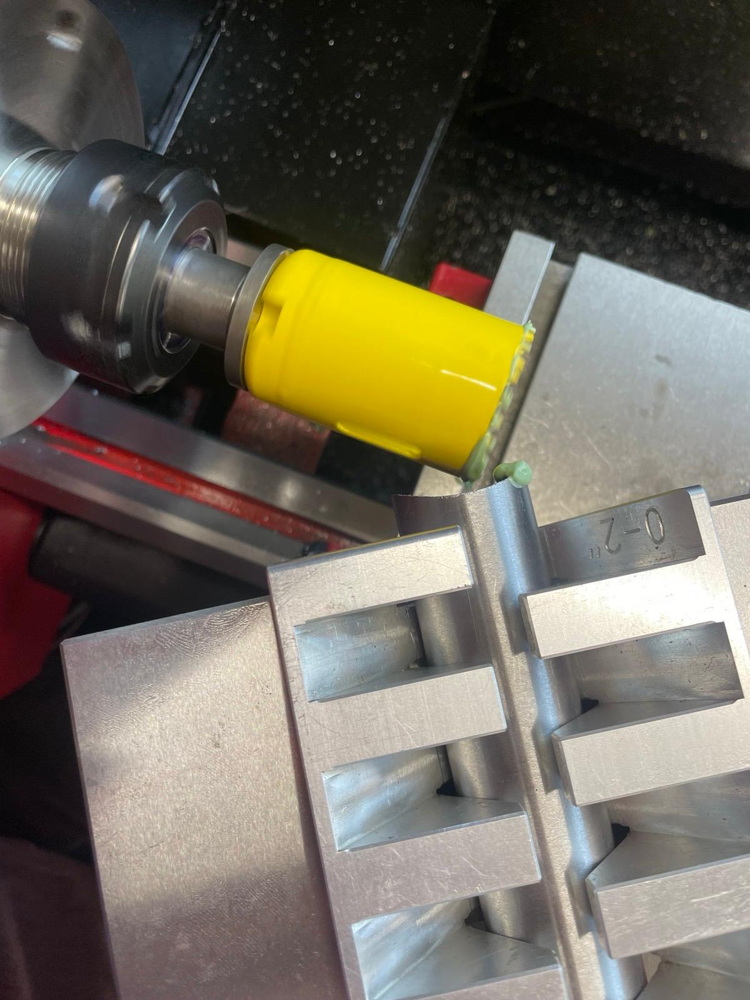
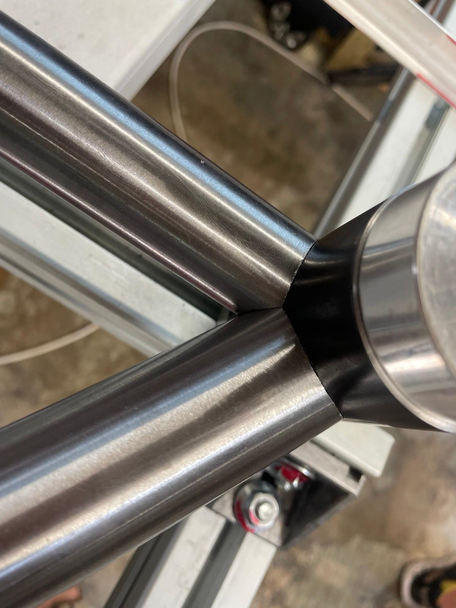
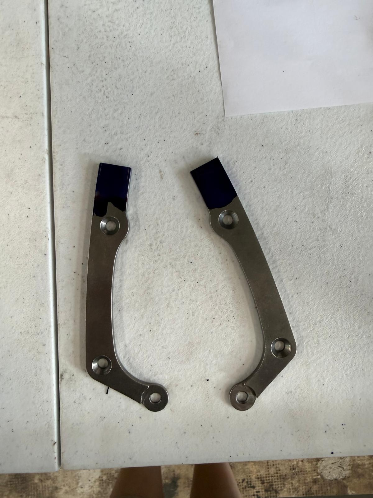

#  cliquette 

made in grenoble with lots of love, sweat and flux.
currently hibernating.

a fillet brazed steel bike: Rohloff hub, Gates belt, SON dynamo, disc brakes, 700c x 40 mm tyres.

## geometry

adapted & inspired by the Trek Checkpoint SL 5, 54 cm: https://geometrygeeks.bike/bike/trek-checkpoint-sl5-2021/

(the numbers below match the 2022-2023 listing: https://bikeinsights.com/bike-geometries/640d62a8c4a612001b5131e1-2023-trek-bikes-checkpoint-sl-5-54-cm)

| | cliquette | Checkpoint SL 5, 54 cm |
|---|---|---|
| head angle | 71.8° | 71.8° |
| seat angle | 73.2° | 73.2° |
| BB drop | 76 mm | 76 mm |
| chainstay | 435 mm | 435 mm |
| front-centre | 617.8 mm | 617.4 mm |
| fork rake | 45 mm | 45 mm |
| fork axle-to-crown | 405 mm (+ 12 mm external lower headset cup) | not published, ~410 mm by calculation |
| head tube | 130 mm | 125 mm |
| stack | ~580 mm | 571 mm |

cliquette numbers are from `bike_final_after_main_triangle_brazing.bcad`. Stack comes out ~8-11 mm higher than the Checkpoint (longer head tube + external lower headset cup) = a Checkpoint with ~10 mm of spacers. So: keep the fork at 405 / 45, zero spacers.

more drawings in [bike_geometry](./bike_geometry), part docs in [parts_docs](./parts_docs).

## parts

- BB shell: McMaster 89955K601 Easy-to-Weld 4130 Alloy Steel Round Tube, 0.188" Wall Thickness, 2" OD, 1 Foot Long
- Tubing (ZON = Columbus Zona):
    - TT ZONM11560 (ref 104)
    - DT ZONL12670001 (ref 103)
    - ST ZON113640 (ref 78)
    - Seatstays ZON615560 x2 (ref 85)
    - Chainstays ZON114OV425 x2 (ref 79)
    - HT HT2010 (Paragon, for 44 mm cups)
    - Seatclamp ZSC300
- Steerer: Steerer, Steel, Tapered 1-1/8" to 1-1/4", 9" Long × 1 (firsthand framebuilding)
- Rear dropouts:
    - right side (drive):
        - Polydrop QR. open up: solves belt opening.
        - Adaptor gates - rohloff beltline
        - Gates sprocket
    - left side (disc):
        - Polydrop
        - OEM2 axle plate (drill a hole on the dropout to hold the oem rather than have monkey bone also because the polydrops i got are not iso). From https://www.rohloff.de/en/service/handbook/oem
- Front dropouts:
    - SON SL Stainless Steel Dropouts - Wide Braze Tab. Product code: 38069 (6 mm thick, 16 mm braze tab, 2 eyelets)
    - SON SL Contact Parts Kit with Cable Exit - 45 degree
- Hubs:
    - rear: 36 hole OEM DB TS Rohloff. O.L.D: 135
    - front: SON 28 SL 6-Bolt Disc Dynamo Hub - 9 x 100mm - Red. Product code: 38808H36. Holes: 36
- Headset: Cane Creek Hellbender 70 Mid-Range Headset - Tapered - ZS44/28.6 | EC44/40 - red
- EBB: PF30-EBB-BLK Eccentric BB for PF30 & 24mm (Shimano) Cranks - Black
- Gates sprockets and crankset:
    - Gates CDX BLACK Rear Sprocket Rohloff - 20T (78980556)
    - Gates CDX Crank Set Direct Mount Rohloff Beltline - 50t (CDXKGA50DMR170)
- Wheel: 700, 40mm tire
- tube blocks https://www.thingiverse.com/thing:4557823
- jig bits https://ideas2cycles.com/simple-framebuilding-jig/. more jig ideas: https://theframebuilders.com/bike-jigs/

## good resources

- brazing: https://www.youtube.com/watch?v=OjRMbBl_Tbs, https://www.youtube.com/watch?v=fzI3QHfZPUs, https://www.youtube.com/watch?v=Y2CnJ9lmlQo, brompton: https://www.youtube.com/watch?v=G0zAORVqnaU
- oxy-propane info: https://noviceframebuilder.co.uk/personal-articles/oxy-propane-brazing-update-3/, https://www.bikeforums.net/framebuilders/1187246-propane-flame.html, [oxy acetylene] https://thejimbosliceworkshop.com/temperature-of-oxy-acetylene-flame/
- start-to-finish bike building: https://www.youtube.com/watch?v=iDx8c7Tq4PY&list=PLUJnSFSlakCKcqDTKFwkHSVIxR1PRioMY

## stuff already done (summer 2026)

- 26 - 27/07: Mitered, bored and faced BB from McMaster blank

 [before / after dims]

- 27 - 28/07: Set up jig, practiced brazing icicle (Paul Brodie exercise, first brazing video in good resources)

- 29/07: Miters: DT-BB, DT-HT (largest butt there per Paul Brodie) yikes - this did not fit! jig setup was wrong in several ways. On to cliquette v3.2; practice brazing ++

- 30/07: Practice brazing; Mitered ST-BB, ST notch (DT-BB junction)

- 31/07: Practice brazing: tube bends before braze snaps - that's good!; NS + brass fillet brazed BB-DT, checked alignment and bent tube back into shape; holes in BB for DT + ST + drain hole (guestimated). Cleaned up flux on DT-BB. Mitered TT-ST and TT-HT - could have used more length on this! large butts. larger butt to HT per Paul Brodie.

- 01/08: Filed ST notch to fit with brazing. Holes in HT for TT and DT; NS + brass fillet brazed the main triangle! (tacked in Paul Brodie order: https://www.youtube.com/watch?v=lDHqMyBHAv0, NS all, and then brazed. do over on a section of TT-HT); faced and reamed HT

- 02/08: Cut to length & mitered and slotted chainstays and added relief cut. Filed dropout inserts down. Cliquette went into hibernation.

## to do next

rear triangle:
- [ ] dry-fit, then silver braze the brass guide tubes into the left chainstay (BEFORE brazing the chainstays)
- [ ] hole in seatstays for brazing
- [ ] tack, NS / Brass / Silver braze chainstays
- [ ] Face and ream BB
- [ ] Check + fix alignment
- [ ] Miter seatstays to fit
- [ ] tack, NS / Brass / Silver braze seatstays
- [ ] bridges for seatstays and chainstays to fit, with a bottle boss in each for the mudguards
- [ ] rear disc tab, fitted with the real hub + rotor + caliper

main triangle:
- [ ] guide tubes through the down tube, grommet holes for the rear light wire
- [ ] bosses: bottle, rack, eyelets
- [ ] ream seat tube, then cut the slot

fork:
- [ ] settle the pending questions below, order parts
- [ ] build a fork fixture (flat plate + dummy axle)
- [ ] build the fork: guide tube + dynamo wire holes while the blades are loose, braze, dropouts, disc tab last

then:
- [ ] build wheels
- [ ] rust protection inside the tubes, paint
- [ ] write up jig setup and chainstay setup here

## decisions so far (22/11)

- internal routing: everything internal, in brass guide tubes silver brazed (56%) into the frame, full-length housing / hose inside.
    - 2 x Rohloff shift cables + rear brake: down tube -> out just before the BB (EBB fills the shell, so ~10 cm exposed under the BB) -> left chainstay. Fit the chainstay guide tubes BEFORE brazing the chainstays. dry-fit first, chainstay is tight.
    - front brake: inside left fork blade (holes on inner / outer face, not front / back)
    - dynamo: front wire inside right fork blade (SL contact), rear light wire through the frame, no guide tube, rubber grommets
    - McMaster: brass tube 1/4" OD, 0.222" ID, 3 ft [8859K188](https://www.mcmaster.com/8859K188) x 6 (+ 1 ft [8859K24](https://www.mcmaster.com/8859K24) x 2 to practice), spring bender [2420A111](https://www.mcmaster.com/2420A111), EPDM grommets 3/16" hole, 1/8" ID [9600K311](https://www.mcmaster.com/9600K311) (or red silicone [1061T167](https://www.mcmaster.com/1061T167)), heat shrink 1/4" ID (0.03" wall), round file 1/4"
    - housing covers for entry / exit holes: https://framebuildersupply.com/products/internal-housing-cover-2-10-packs
- bosses: all stainless, silver brazed, from Framebuilder Supply
    - [bottle bosses](https://framebuildersupply.com/products/stainless-steel-water-bottle-bosses-pack-of-10) x 2 packs: 3 cages (2 on DT top + ST, 1 under DT) + 1 in each bridge + 1 under the fork crown for mudguards. 1/4" drill.
    - [reinforcing stars](https://framebuildersupply.com/products/water-bottle-boss-reinforcing-stars-stainless-steel-pack-of-10) x 1 pack
    - [eyelet bosses](https://framebuildersupply.com/products/eyelet-bosses-for-m5-bolts-stainless-10-100-packs) x 1 pack (mudguard stays at dropouts)
    - [rack bosses](https://framebuildersupply.com/products/rack-bosses-for-m5-bolts-stainless-steel-pack-of-10) x 1 pack (seatstays, fork blades)
- disc brakes: IS tabs front and rear ([ISO tab](https://framebuildersupply.com/products/iso-disc-brake-tab-cast)), 160 mm rotors. Front = 6-bolt (SON), rear = Rohloff-specific 4-bolt rotor. Fit the tabs with the real hub + rotor + caliper in place.
- fork: steel, disc, Columbus disc-rated blades, 405 axle-to-crown, 45 rake, SON SL dropouts (wide 16 mm tab, slotted into the blade tip - matches the 16 mm tip of the pre-raked blades) angled forward (disc pushes the axle out of a QR dropout). Type still open, see below.
- seat tube: ream after all brazing and before cutting the slot (adjustable reamer for 27.2 or a brake cylinder hone). No facing needed, file the top square.

## pending questions - fork, steerer, cane creek

- crown or unicrown?
    - option A, crown + curved blades (the one i want): [Columbus pre-raked disc blades](https://framebuildersupply.com/products/columbus-pre-raked-fork-blades-for-disc-28x19-oval-1-2-9-wall-45mm-rake-length-475) (28x19 oval, 1.2/.9, 45 rake, tip 16 mm OD, trim from the top only) + [Pacenti Paris-Brest crown 1-1/8"](https://framebuildersupply.com/products/pacenti-1-1-8-paris-brest-fork-crown-56mm-inside-width-biplane-design) (56 mm inside) or the beefier [Pacenti MTB crown](https://framebuildersupply.com/products/pacenti-mtb-fork-crown-74mm-inside-width-biplane-design) (74 mm inside). Needs a straight 1-1/8" steerer.
    - option B, unicrown, straight blades: [Columbus tapered unicrown disc blades](https://framebuildersupply.com/products/columbus-unicrown-fork-blades-28-6mm-round-15mm-id-tip-1-2-1-wall-length-440) (28.6 round, 440 long) fillet brazed straight onto the tapered steerer i already have. Sold for disc, no crown in question.
- is a lugged crown ok with a disc brake? The blades are disc-rated, but no supplier states it for any crown. -> email Framebuilder Supply (hello@framebuildersupply.com, 971.251.0092): which 1-1/8" crown for a disc fork with these blades, max rotor size, steerer restock.
- steerer:
    - the one i have (tapered 1-1/8" to 1-1/4", 9" = 228 mm) only works for unicrown, and is very tight: need 187 mm above the crown race seat (12 + 130 + 8 + 40 stem - 3) + ~35-40 mm for the blade joints. Zero spacers, no margin. Measure crown race seat to top: under ~190 mm = buy a longer one.
    - crown option needs a straight 1-1/8": Columbus 2.3/1.55 wall, 350 mm ([link](https://framebuildersupply.com/products/columbus-threadless-1-1-8-28-6-steerer-tube-350-length)) - sold out at Framebuilder Supply on 22/11, same for the lightweight 320 mm one. Find elsewhere or wait for restock.
- cane creek headset: the Hellbender lower (EC44/40) wants a 40 mm crown race seat (1.5" steerer), neither steerer fits as is. Keep the headset, swap only the crown race:
    - tapered 1-1/4" steerer -> Cane Creek 110-Series 52/33 conversion crown race (BAA0902A-01 / HD2461)
    - straight 1-1/8" steerer -> Cane Creek 52/30 reducer crown race (1.5" to 1-1/8")
    - listings say 10 / 40 / 110-Series, none names the Hellbender -> check the lower bearing is 52 mm OD / 40 mm ID, or ask Cane Creek.
- brake calipers: cable or hydraulic? Depends on the Rohbox levers (pair of SRAM mechanical-shift road levers). Leaning cable: TRP Spyre or Paul Klamper, post mount on IS adapters, compressionless housing.

## to figure out

- wheels : rims (H PLUS SON TB14 is a narrow rim-brake rim -> rather a 36h disc rim, 19-23 mm inner: Ryde Andra 30, DT Swiss TK 540, Velocity Dyad / Cliffhanger), spokes (Sapim Race / DT Competition 2.0/1.8/2.0, Rohloff 2-cross, SON 3-cross), tires, & mudguards (50 mm over a 40 mm tyre)
- r-box (roh): which levers, check current compatibility with Gebla
- dynamo lights: front (Edelux II / IQ-X) at the crown, rear light + bracket
- badge? name plate? paintjob?
- rust protection inside of tubes: extra long straws to put on end of rust protector spray can https://www.amazon.com/Replacement-Straws-Flexible-Plastic-Extension/dp/B09K3T496C?th=1, https://www.youtube.com/watch?v=3Yi6cjuqVHA

## painting inspo

https://www.behance.net/gallery/28363453/THE-BIKE-PROJECT , https://www.flickr.com/photos/54067629@N02/5062963141/in/photostream/, https://www.designboom.com/design/festka-bespoke-porcelain-spectre-model-12-18-2019/
