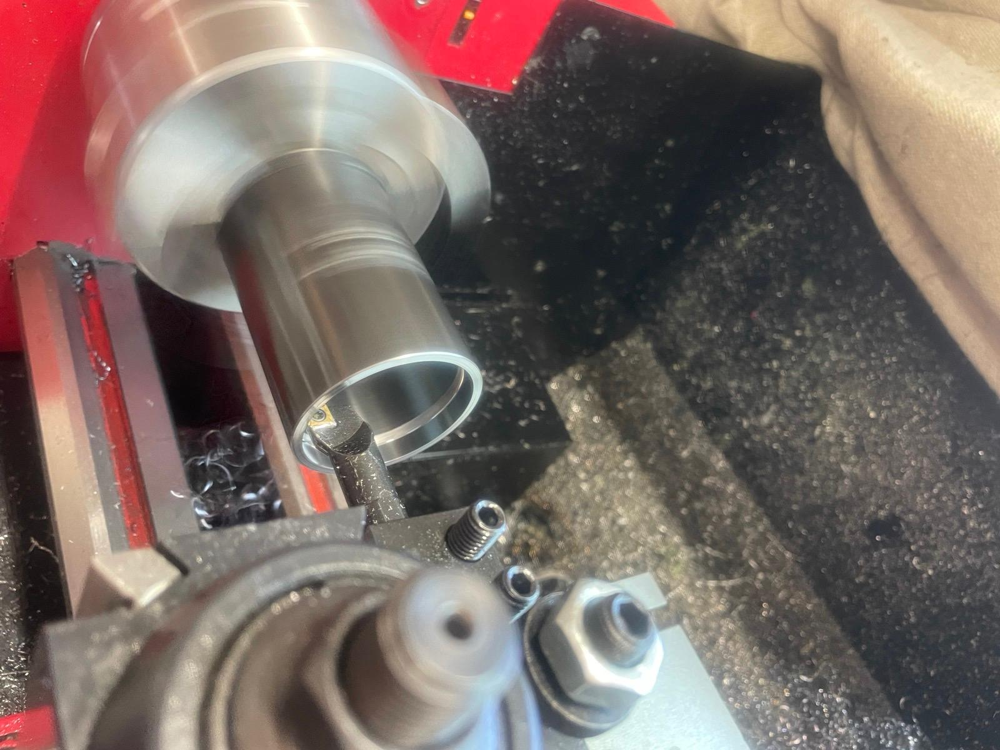
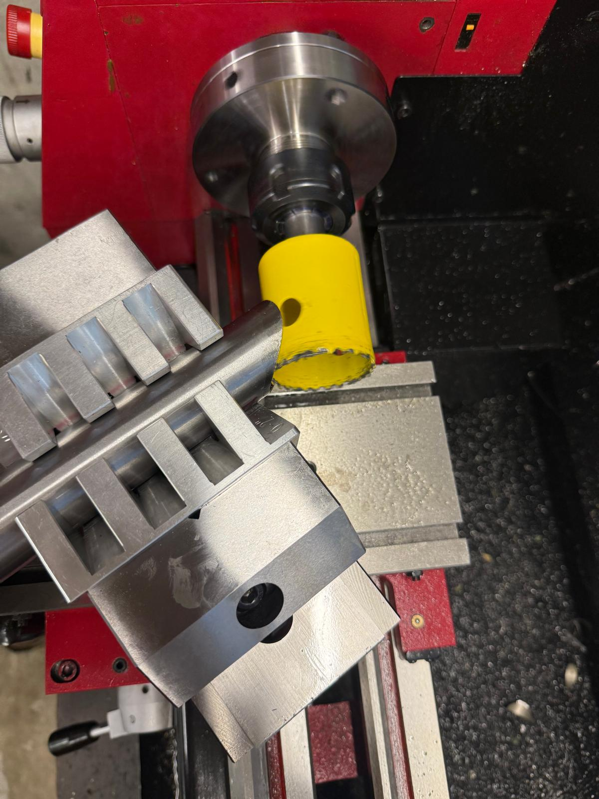
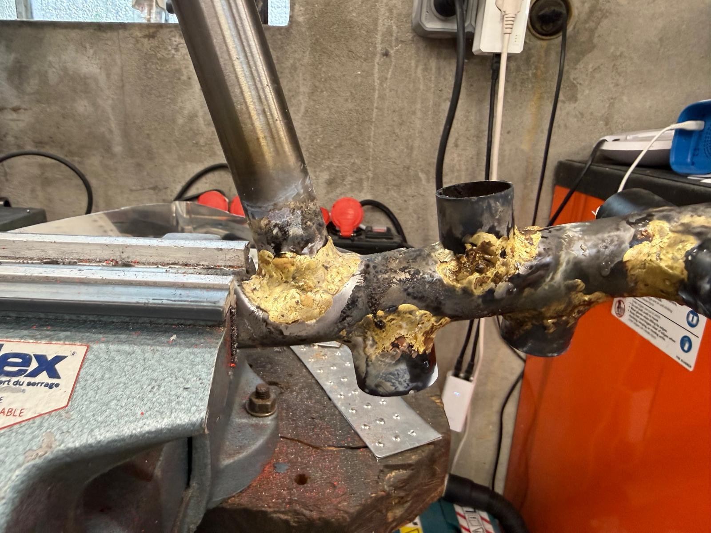
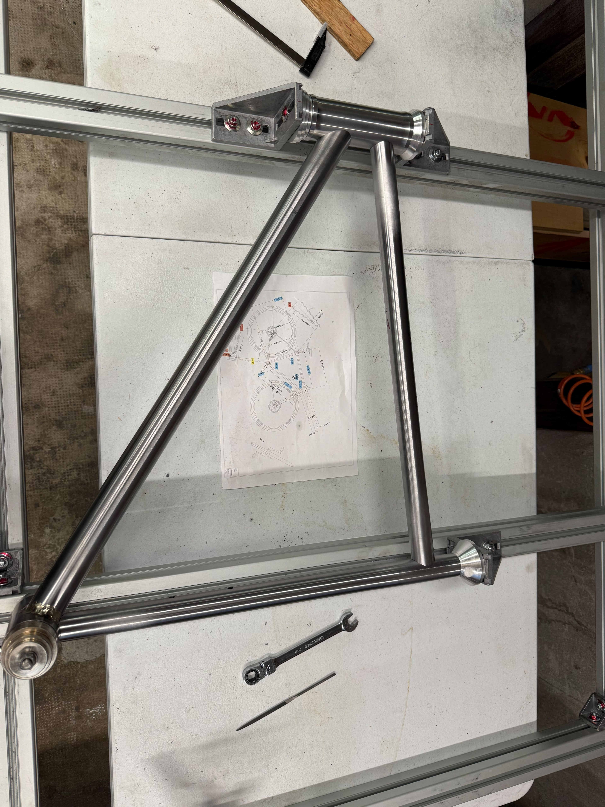

#  cliquette 

made in grenoble with lots of love, sweat and flux.
currently hibernating.

parts: 

- BB: McMaster 89955K601 Easy-to-Weld 4130 Alloy Steel Round Tube, 0.188" Wall Thickness, 2" OD, 1 Foot Long
- Tubing :
    - TT ZONM11560 (ref 104)
    - DT ZONL12670001 (ref 103)
    - ST ZON113640 (ref 78)
    - Seatstays ZON615560 x2 (ref 85)
    - Chainstays ZON114OV425 x2 (ref 79)
    - HT HT2010 
    - Seatclamp ZSC300
- Steerer: Steerer, Steel, Tapered 1-1/8" to 1-1/4", 9" Long × 1 (firsthand framebuilding)
- Rear dropouts:
  - right side (drive): 
        - Polydrop QR. open up: solves belt opening. 
        - OEM2 axle (drill a hole on the dropout to hole the oem rather than have monkey bone also because the polydrops i got are not iso). From https://www.rohloff.de/en/service/handbook/oem
  - left side: 
      - Adaptor gates - rolhoff beltline
      - Gates sprocket
      - Polydrop 
- Front dropouts
    - SON SL Contact Parts Kit with Cable Exit - 45 degree
SON 28 SL 6-Bolt Disc Dynamo Hub - 9 x 100mm - Red
Product code: 38808H36
Holes: 36

- Headset: 
        - Cane Creek Hellbender 70 Mid-Range Headset - Tapered - ZS44/28.6 | EC44/40 - red
- EBB: PF30-EBB-BLK	Eccentric BB for PF30 & 24mm (Shimano) Cranks - Black
- Gates sprockets and crankset:
    - Gates CDX BLACK Rear Sprocket Rohloff -20T (78980556)
	- Gates CDX Crank Set Direct Mount Rohloff Beltline - 50t (CDXKGA50DMR170)

- Hubs:
    - 36 hole OEM DB TS Rolhoff. O.L.D: 135
 
- Wheel : 700, 40mm tire 
- tube blocks https://www.thingiverse.com/thing:4557823
- jig bits https://ideas2cycles.com/simple-framebuilding-jig/. more jig ideas: https://theframebuilders.com/bike-jigs/

good resources:
- brazing: https://www.youtube.com/watch?v=OjRMbBl_Tbs, https://www.youtube.com/watch?v=fzI3QHfZPUs, https://www.youtube.com/watch?v=Y2CnJ9lmlQo, brompton: https://www.youtube.com/watch?v=G0zAORVqnaU
- oxy-propane info: https://noviceframebuilder.co.uk/personal-articles/oxy-propane-brazing-update-3/, https://www.bikeforums.net/framebuilders/1187246-propane-flame.html, [oxy acetlyene] https://thejimbosliceworkshop.com/temperature-of-oxy-acetylene-flame/, 
- start-to-finish bike building: https://www.youtube.com/watch?v=iDx8c7Tq4PY&list=PLUJnSFSlakCKcqDTKFwkHSVIxR1PRioMY

stuff already done: 
- 26 - 27 /07: Mittered, bored and faced BB from McMaster blank 

 [before / after dims]
 
- 27 - 28 /07: Set up jig, practiced brazing icicle (Paul Brodie exercise: https://www.youtube.com/watch?v=OjRMbBl_Tbs, more vids: https://www.youtube.com/watch?v=fzI3QHfZPUs, https://www.youtube.com/watch?v=Y2CnJ9lmlQo)

- 29 / 07: Miters : DT-BB, DT-HT (largest but there per Paul Brodie) yikes - this did not fit! jig setup was wrong in several ways. On to cliquette v3.2; practice brazing ++

- 30/07: Practice brazing; Mitered ST-BB , ST notch (DT-BB junction), 

- 31/07: Practice brazing: tube bends before braze snaps - that's good!; NS + brass fillet brazed BB-DT, checked alignement and bent tube back into shape; holes in BB for DT + ST + drain hole (guestimated). Cleaned up flux on DT-BB. Mitered TT-ST and TT-HT - could have used more length on this! large buts. lerger but to HT per Paul Brodie. 

- 01/08: Filed ST notch to fit with brazing. Holes in HT for TT and DT; NS + brass fillet brazed the main triangle! (tackecd in Paul Brodie order: https://www.youtube.com/watch?v=lDHqMyBHAv0, NS all, and then brazed. do over on a section of TT-HT); faced and reamed HT; 

- 02/08: Cut to length & mitered and slotted chainstays and added relief cut. Filled dropout inserts down. Cliquette went into hibernation. 

jig setup: 

Chainstay setup: 

to do next: 
 - hole in seatstays for brazing 
 - tack, NS / Brass / Silver braze chainstays
 - Face and ream BB
 - Check + fix alignement 
 - Miter seatstays to fit 
 - tack, NS / Brass / Silver braze seatstays
 - build wheel 
 - bridge bosses 
 - bridges for seatstays and chainstays to fit 

to figure out: 
- cables & internal routing. jagwire? 
- wheels : rims (H PLUS SON TB14 36holes?, Velocity Aero Disc? ($$$)), spokes (sapim R-compatible), tires, & mudguards
- bosses - how many & where they should go
- fork, fork blades and how that will work with disc brakes 
- seat tube reamer / facer 
- r-box (roh) 
- dynamos
- badge? name plate? paintjob?
- rust protection inside of tubes: exyra long straws to put on end of rust protector spray can https://www.amazon.com/Replacement-Straws-Flexible-Plastic-Extension/dp/B09K3T496C?th=1, https://www.youtube.com/watch?v=3Yi6cjuqVHA

Painting inspo: https://www.behance.net/gallery/28363453/THE-BIKE-PROJECT , https://www.flickr.com/photos/54067629@N02/5062963141/in/photostream/, https://www.designboom.com/design/festka-bespoke-porcelain-spectre-model-12-18-2019/
